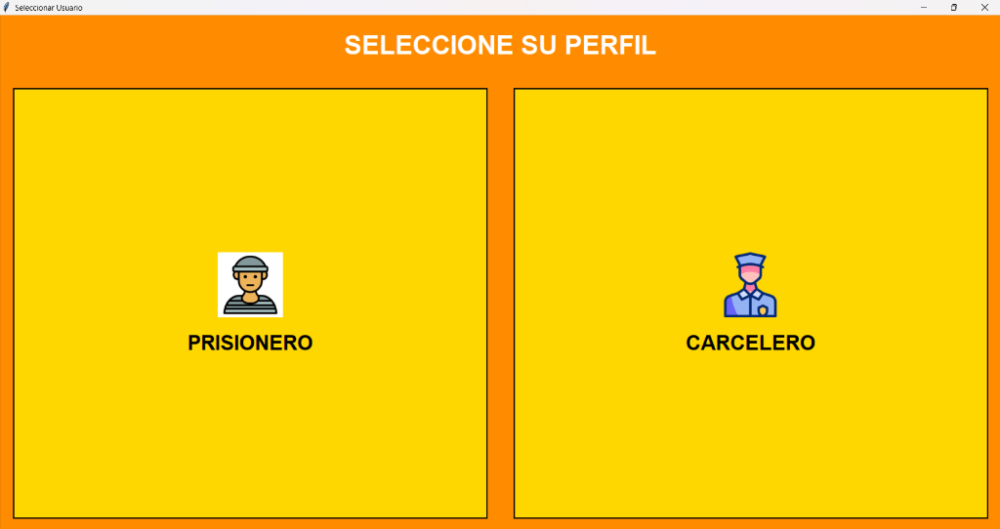
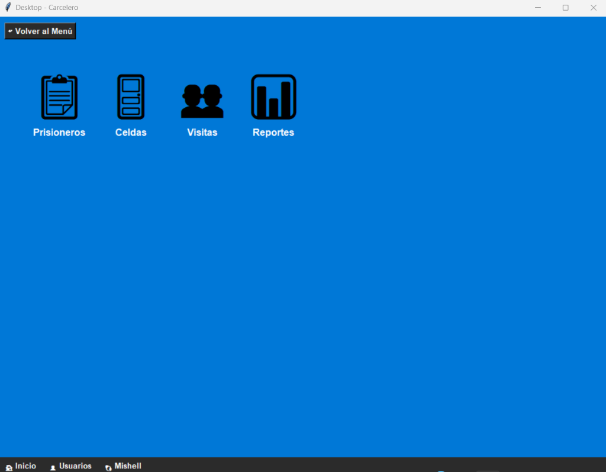

# 🐧 Desktop-JailLinux

> **Entorno de escritorio interactivo y simulador de políticas de seguridad en sistemas operativos (Roles Carcelero / Prisionero) desarrollado en Python y Tkinter.**

<p align="left">
  <a href="LICENSE">
    
  </a>
  
  
  
</p>

<p align="center">
  
  
</p>

---

## 🎯 Descripción del Proyecto

**Desktop-JailLinux** es una aplicación de escritorio que emula el control de acceso basado en roles (RBAC) y la gestión de entornos de ejecución restringidos (*chroot / jail*) para un sistema operativo temático penitenciario.

Forma parte de la suite **JailLinux** desarrollada en la **Universidad Camilo José Cela (UCJC)** para la materia de **Sistemas Operativos**.

---

## 🏗️ Arquitectura y Componentes

La solución cuenta con más de 1.100 líneas de código organizadas en arquitectura modular:

```text
├── dekstop.py        # Launcher principal de autenticación y selección de rol
├── carcelero.py      # Entorno de administración (Warden Desktop)
├── prisionero.py     # Entorno restringido en Sandbox (Inmate Desktop)
├── requirements.txt  # Dependencias del proyecto
└── LICENSE           # Licencia abierta MIT
```

### 👮‍♂️ 1. Rol Carcelero (`carcelero.py` — Panel Administrativo)
- Control integral del sistema, supervisión de procesos y monitoreo de actividad.
- Gestión de usuarios y permisos de ejecución.
- Registro y auditoría en tiempo real de eventos de seguridad.
- Ejecución controlada de subprocesos y comandos administrativos.

### ⛓️ 2. Rol Prisionero (`prisionero.py` — Sandbox Restringido)
- Entorno de escritorio confinado (*Jail*) con principio de mínimo privilegio.
- Restricción estricta de aplicaciones accesibles y control de tiempos de sesión mediante temporizadores.
- Interceptación y bloqueo de llamadas o comandos fuera de la lista blanca (*allowlist*).

---

## 🚀 Instalación y Puesta en Marcha

### Requisitos Previos
* **Python 3.9 o superior**.
* En Linux/Ubuntu (si no dispones de Tkinter instalado):
  ```bash
  sudo apt install python3-tk
  ```

### Ejecución

1. **Clona el repositorio:**
   ```bash
   git clone https://github.com/Cristiangarcia913/Desktop-JailLinux.git
   cd Desktop-JailLinux
   ```

2. **Instala las dependencias:**
   ```bash
   pip install -r requirements.txt
   ```

3. **Inicia el lanzador de escritorio:**
   ```bash
   python dekstop.py
   ```
   *Desde el menú principal podrás seleccionar si iniciar la sesión como Carcelero o como Prisionero.*

---

## 👨‍💻 Autor

**Cristian García Del Olmo**
* Grado en Ingeniería Informática — **Universidad Camilo José Cela (UCJC)**
* GitHub: [@Cristiangarcia913](https://github.com/Cristiangarcia913)
* LinkedIn: [Cristian García Del Olmo](https://www.linkedin.com/in/cristian-garc%C3%ADa-del-olmo-7b8551333)

---

## 📄 Licencia

Este proyecto está bajo la Licencia MIT. Consulta el archivo [LICENSE](LICENSE) para más información.
